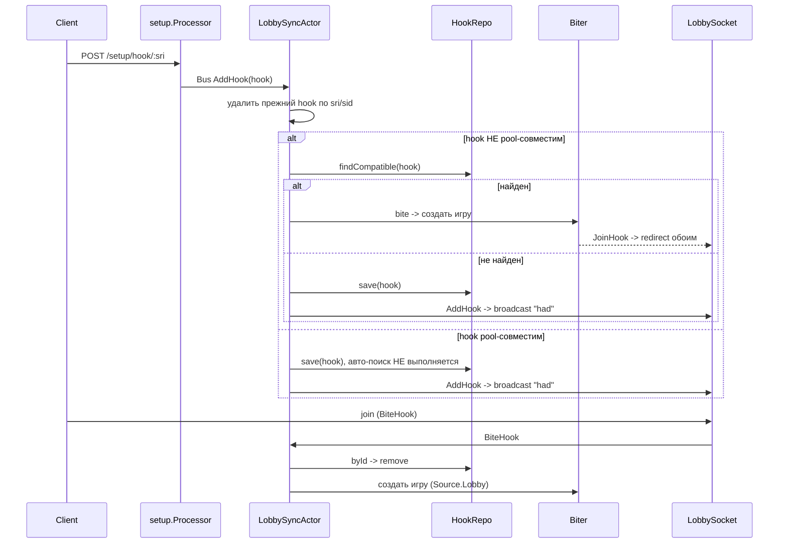
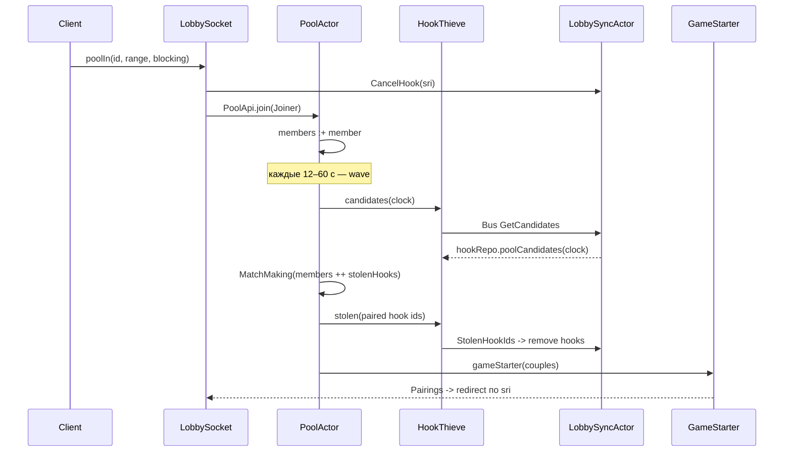

# Объединение путей старта игр: `lobby` и `pool`

Статус: предложение (не реализовано)
Дата: 2026-10-21
Рекомендуемый вариант: **B — видимость + низконагрузочный режим слияния**

---

## 1. Как сейчас устроены две ветки

### 1.1. Lobby (hooks)



Ключевые точки:

- `modules/lobby/src/main/LobbySyncActor.scala:35-46` — приём хука.
- `LobbySyncActor.scala:40` — **главная развилка**: `(!hook.compatibleWithPools).so(findCompatible(hook))`. Для pool-совместимого хука автоматический матчинг в лобби отключается.
- `Hook.scala:86-90` — pool-совместимость: rated + standard + clock из списка пулов + `color == Random`.
- `LobbySyncActor.scala:65-67`, `141-146` — ручной bite хука.
- `Biter.scala:24-37` — создание игры с `Source.Lobby`.
- `LobbySocket.scala:69-80`, `112-116` — рассылка `had`/`hooks` подписчикам вкладки `real_time`.

### 1.2. Pool (quick pairing)



Ключевые точки:

- `LobbySocket.scala:188-216` — вход в пул, `CancelHook` и `PoolApi.join`.
- `PoolApi.scala:33-40` — `join` проверяет playban и выходит из остальных пулов.
- `PoolActor.scala:40-48` — добавление в `members`, `FullWave` только при `members >= wave.players`.
- `PoolActor.scala:62-94` — волна: stolen hooks + собственные участники → `MatchMaking`.
- `HookThieve.scala:9-17` — запрос кандидатов и удаление «украденных» хуков.
- `GameStarter.scala:23-52` — создание игр с `Source.Pool`, публикация `Pairings`.

### 1.3. Что фактически видно в лобби

| Ожидающий игрок | Виден в `real_time` | Можно нажать «join» | Как создаётся игра |
|---|---|---|---|
| Анонимный hook с clock пула | да | да | `Source.Lobby` через `Biter` |
| Авторизованный custom hook | да | да | `Source.Lobby` |
| Авторизованный pool-совместимый hook | **да** | да | `Source.Lobby` (пул не участвует) |
| Авторизованный участник пула | **нет** | — | только волна, `Source.Pool` |
| Уже начатая игра из пула | да, во вкладке `now_playing` | — | — |

То есть started-игры из пула уже видны в `now_playing`, а «слепое пятно» — именно **ожидающие участники пула**. При этом pool-совместимые хуки уже видны в лобби, но их автоматический матчинг искусственно отключён.

---

## 2. Найденные проблемы и ограничения

1. **Участники пула не имеют представления в лобби.** `PoolActor.members` — приватное состояние, наружу не публикуется. `PoolApi` (`modules/core/src/main/pool.scala:64-68`) не отдаёт ни список, ни количество.
2. **Нет username/реального рейтинга в pool-модели.** `PoolMember` (`modules/core/src/main/pool.scala:24-34`) содержит jittered `rating` (см. `LobbySocket.scala:284-289`) и не содержит `username`. Для отображения в лобби этого недостаточно.
3. **Гонка «hook украден пулом, но ещё не удалён».** `GetCandidates` возвращает снимок хуков, а удаление происходит только после `MatchMaking` через `StolenHookIds` (`LobbySyncActor.scala:129-133`). В этом окне другой клиент может сделать `BiteHook`, и `Biter` создаст игру с тем же владельцем хука — возможны две игры на одного игрока.
4. **Нет серверной взаимоисключаемости пула и хука.** `poolIn` отменяет хук (`LobbySocket.scala:200`), но создание хука не выводит из пула. UI это делает (`setupCtrl.ts:192`), сервер — нет. При прямом API-вызове можно оказаться в пуле и с хуком одновременно.
5. **Асимметрия анонимов.** Аноним не может войти в пул; его pool-хук виден авторизованным и может быть «укушен». Участники пула всегда авторизованы.
6. **`HookRepo` не является единым реестром ожидающих.** Это реестр хуков; участники пула живут в отдельном акторе. Отсюда два независимых пути удаления/резервирования.

---

## 3. Варианты реализации

### Вариант A. Только видимость (минимальный риск)

Публиковать состав пулов через `Bus` → `LobbySocket` → клиент. В `real_time` показывать участников пула отдельными строками с действием «войти в пул». Матчинг не меняется.

- Плюсы: не трогаем `Biter`, `HookRepo`, волны; низкий риск.
- Минусы: две сущности в одном списке, но клик всё равно ведёт в пул и нужно ждать волну.

### Вариант B. Видимость + низконагрузочный режим слияния (**рекомендуется**)

A + адаптивный флаг «мало игроков»:

- при малой нагрузке pool-совместимые хуки снова пробуют немедленный матчинг в лобби;
- пул запускает волну при 2 участниках, а не при `wave.players`;
- участники пула видны в общем списке.

- Плюсы: реально объединяет ветки в low-load, при высокой нагрузке поведение не меняется.
- Минусы: нужен порог и осторожное тестирование.

### Вариант C. Единый реестр ожидающих (полное объединение)

Участники пула становятся «хуками» с признаком `poolId` в `HookRepo`; волны работают по этому же реестру; все удаления/резервирования — в одном акторе. Клик по участнику пула может как входить в пул, так и сразу создавать игру.

- Плюсы: одна модель состояния, нет рассинхронизации.
- Минусы: крупный рефакторинг `Hook`, `HookRepo`, `HookThieve`, `PoolActor`, риск регрессий в матчинге. Оправдан только если нужен мгновенный прямой вызов игрока из пула.

### Рекомендация

**Вариант B, поэтапно.** Сначала видимость и режим, затем слияние матчинга, затем — при необходимости — укрепление резервирования. Вариант C не обязателен: после B пользователь видит всех и попадает в игру за время одной волны.

---

## 4. Пошаговый план реализации (Вариант B)

### Шаг 1. Инфраструктура режима слияния

**Файлы:**

- `conf/base.conf` — новый блок:

  ```hocon
  lobby {
    # 0 = режим слияния выключен
    # при количестве онлайн-участников лобби ниже порога включается объединённый режим
    merge_below_players = 0
  }
  ```

- `modules/lobby/src/main/Env.scala` — добавить `appConfig: play.api.Configuration`, прочитать:

  ```scala
  private val mergeBelowPlayers =
    appConfig.getOptional[Int]("lobby.merge_below_players").getOrElse(0)
  ```

  и передать в `LobbySocket` (явным параметром либо через небольшой case class, чтобы macwire не пытался сам подставить `Int`).

- `modules/core/src/main/pool.scala` — в trait `PoolApi`:

  ```scala
  def setMergeMode(enabled: Boolean): Unit
  ```

- `modules/pool/src/main/PoolApi.scala`:

  ```scala
  def setMergeMode(enabled: Boolean): Unit =
    actors.values.foreach(_ ! SetMergeMode(enabled))
  ```

- `modules/pool/src/main/PoolActor.scala` — сообщение `SetMergeMode(enabled: Boolean)` и поле `private var mergeMode = false`. Пока без изменения матчинга.

- `modules/lobby/src/main/LobbySocket.scala` — поле `private var mergeMode = false`; в обработчике `In.Counters`:

  ```scala
  case In.Counters(m, r) =>
    lastCounters = LobbyCounters(m, r)
    val enabled = mergeBelowPlayers > 0 && m < mergeBelowPlayers
    if enabled != mergeMode then
      mergeMode = enabled
      lobby ! LobbySyncActor.SetMergeMode(enabled)
      poolApi.setMergeMode(enabled)
  ```

**Критерии приёмки:**

- `./lila.sh "pool/compile;lobby/compile"` — успешно.
- При `merge_below_players = 0` поведение прежнее (флаг всегда `false`).
- В логах/метрике видно переключение режима (можно добавить `lila.mon.lobby.merge` gauge).

**Зависимости:** нет.

---

### Шаг 2. Публикация состава пулов (server-side projection)

**2.1. Расширить модель.**

`modules/core/src/main/pool.scala`:

```scala
case class Joiner(
    sri: Sri,
    rating: IntRating,          // jittered, для матчинга — как сейчас
    displayRating: IntRating,   // реальный рейтинг, только для отображения
    provisional: Boolean,
    ratingRange: Option[RatingRange],
    lame: Boolean,
    blocking: Blocking,
    username: UserName
)(using val me: MyId)

case class PoolMember(
    userId: UserId,
    username: UserName,
    sri: Sri,
    rating: IntRating,
    displayRating: IntRating,
    provisional: Boolean,
    ratingRange: Option[RatingRange],
    lame: Boolean,
    blocking: Blocking,
    rageSitCounter: Int,
    misses: Int = 0
)

/** Внутреннее сообщение Bus; содержит blocking, клиенту не отдаётся как есть. */
case class PoolMembers(
    poolId: PoolConfigId,
    clock: chess.Clock.Config,
    members: Vector[PoolMember]
)
```

**2.2. Обновить места конструирования.**

- `modules/lobby/src/main/HookRepo.scala:73-85` (`toPool`): `username = h.username`, `displayRating = h.rating | lila.rating.Glicko.default.intRating`.
- `modules/pool/src/main/PoolMember.scala:19-28`: `username = joiner.username`, `displayRating = joiner.displayRating`.
- `modules/lobby/src/main/LobbySocket.scala:206-216`: в `Joiner` добавить:

  ```scala
  displayRating = user.ratingAt(perfType),
  username = user.username,
  ```

**2.3. Публикация из `PoolActor`.**

```scala
private var mergeMode = false

private def publishMembers(): Unit =
  if mergeMode then
    lila.common.Bus.publish(
      lila.core.pool.PoolMembers(config.id, config.clock, members),
      "poolMembers"
    )
```

Вызывать `publishMembers()`:

- после добавления участника в `Join`;
- после изменения `ratingRange` существующего участника (сейчас `PoolActor.scala:45-48`);
- после `Leave`;
- после фильтрации по `Sris` (`PoolActor.scala:96-98`);
- после `members = members.diff(pairedMembers)` (`PoolActor.scala:82`);
- при `SetMergeMode(true)` — чтобы `LobbySocket` сразу получил актуальные снимки.

**2.4. Приём и рассылка в `LobbySocket`.**

Внутри `actor`:

```scala
private var mergeMode = false
private val poolMembers = collection.mutable.Map.empty[PoolConfigId, Vector[lila.core.pool.PoolMember]]

case SetMergeMode(enabled) =>
  mergeMode = enabled
  if !enabled then
    send.exec(P.Out.tellSris(hookSubscriberSris.map(Sri(_)), makeMessage("pmem", Json.arr())))

case lila.core.pool.PoolMembers(poolId, clock, members) =>
  if members.isEmpty then poolMembers.remove(poolId)
  else poolMembers.update(poolId, members)
  if mergeMode then sendPoolEntries()
```

`sendPoolEntries()` отправляет каждому подписчику `hookSubscriberSris.diff(idleSris)` персонально отфильтрованный массив:

```scala
private def sendPoolEntries(): Unit =
  hookSubscriberSris.diff(idleSris).foreach { sriStr =>
    members.getIfPresent(sriStr).foreach { member =>
      val entries = poolEntriesFor(member)
      send.exec(P.Out.tellSri(Sri(sriStr), makeMessage("pmem", JsArray(entries))))
    }
  }
```

`poolEntriesFor` собирает JSON в форме, совместимой с `Hook.render`:

```scala
Json.obj(
  "id"     -> s"pool:${poolId}:${m.userId}",
  "pool"   -> poolId,
  "clock"  -> clock.show,
  "t"      -> clock.estimateTotalSeconds,
  "s"      -> Speed(clock).id,
  "i"      -> clock.incrementSeconds,
  "perf"   -> perfType.key,
  "ra"     -> 1,
  "u"      -> m.userId,
  "n"      -> m.username,
  "rating" -> m.displayRating,
  "prov"   -> m.provisional
)
```

Фильтрация видимости (зеркало `Biter.canJoin` для хуков):

```scala
private def visibleTo(viewer: LobbyUser, entry: PoolMember, perfType: PerfType): Boolean =
  !viewer.bot &&
    viewer.id != entry.userId &&                       // свой вход не дублируем
    viewer.lame == entry.lame &&
    !viewer.blocking.value.contains(entry.userId) &&
    !entry.blocking.value.contains(viewer.id) &&
    entry.ratingRange.forall(_.contains(viewer.ratingAt(perfType)))
```

Также при `AllHooksFor` (`LobbySocket.scala:112-116`) после отправки `hooks` отправить `pmem`-снимок этому же sri.

**Критерии приёмки:**

- Компиляция `pool`, `lobby`, `setup`.
- Юнит-тест на `visibleTo` (в `modules/lobby/src/test/`): блокировки в обе стороны, `lame`, rating range, bot.
- Ручной сценарий: два браузера, оба в пуле `5+3`; у второго в `real_time` появляется строка первого; после выхода из пула строка исчезает.
- При выключенном режиме сообщения `pmem` не отправляются.

**Зависимости:** шаг 1.

---

### Шаг 3. UI: объединённый список

**Файлы:**

- `ui/lobby/src/interfaces.ts`:

  ```ts
  export interface PoolEntry extends Omit<Hook, 'action'> {
    pool: PoolId;
    action: 'joinPool';
  }
  ```

  и `Hook.action` дополнить `'joinPool'` (или вынести union в `LobbyEntry`).

- `ui/lobby/src/socket.ts` — обработчик:

  ```ts
  pmem(entries: PoolEntry[]) {
    ctrl.setPoolEntries(entries);
  },
  ```

- `ui/lobby/src/ctrl.ts`:
  - поле `poolEntries: PoolEntry[] = [];`
  - `setPoolEntries` — нормализовать `variant: 'standard'`, `action: 'joinPool'`, перерисовать при `tab === 'real_time'`;
  - `clickHook`: если `hook.action === 'joinPool'`, вызвать `this.enterPool({ id: hook.pool })`, иначе — прежняя логика;
  - при `realTimeOut`/`awake` очищать `poolEntries`.
- `ui/lobby/src/view/realTime/main.ts`:

  ```ts
  const entries = [...ctrl.stepHooks, ...ctrl.poolEntries];
  res = ctrl.filter.filter(entries);
  ```

  для chart-режима — `[...ctrl.data.hooks, ...ctrl.poolEntries]`.

- `ui/lobby/src/view/realTime/list.ts`:
  - заголовок для `joinPool` (`i18n.site.quickPairing` или новая i18n-строка);
  - опционально CSS-маркер `tr.hook.pool` и стиль в `ui/lobby/css/app/_hook-list.scss`.
- `ui/lobby/src/filter.ts` — типы принимают union; фильтрация уже работает, т.к. у записи есть `ra`, `i`, `s`, `t`, `rating`, `variant`.
- `ui/lobby/src/view/pools.ts` (опционально) — бейдж с количеством ожидающих: `ctrl.poolEntries.filter(e => e.pool === pool.id).length`.

**Критерии приёмки:**

- `pnpm check-format`, `pnpm lint`, `pnpm test`.
- `./ui/build lobby`.
- Ручной сценарий: строка участника пула появляется в общем списке, корректно сортируется по рейтингу/времени, скрывается фильтрами, клик переводит во вкладку `pools` и отправляет `poolIn`; после пары — строка исчезает и происходит redirect.

**Зависимости:** шаг 2.

---

### Шаг 4. Слияние матчинга при низкой нагрузке

**4.1. `LobbySyncActor`:**

```scala
case class SetMergeMode(enabled: Boolean)
private var mergeMode = false
```

В `AddHook` (`LobbySyncActor.scala:40`) заменить:

```scala
(!hook.compatibleWithPools).so(findCompatible(hook)) match
```

на:

```scala
val tryLobbyMatch = !hook.compatibleWithPools || mergeMode
tryLobbyMatch.so(findCompatible(hook)) match
```

**4.2. `PoolActor`:**

```scala
case SetMergeMode(enabled) =>
  mergeMode = enabled
  if enabled && members.sizeIs >= 2 then self ! FullWave
  if enabled then publishMembers()

case Join(joiner, rageSit) =>
  ...
  val needed = if mergeMode then 2 else config.wave.players.value
  if members.sizeIs >= needed then self ! FullWave
```

**Критерии приёмки:**

- При `merge_below_players = 0` — полная регрессия: pool-хуки не матчатся автоматически, волны по прежнему порогу.
- При включённом режиме два подряд созданных pool-совместимых хука (`5+3`, rated, random) создают игру сразу, без ожидания волны.
- При включённом режиме второй участник пула получает игру в течение ближайшей волны (порог 2), а не ждёт `wave.players`.
- Мониторинг: число игр `Source.Lobby` vs `Source.Pool` меняется предсказуемо; нет всплеска duplicate-game.

**Зависимости:** шаг 1; логически независим от шагов 2–3.

---

### Шаг 5. Укрепление: резервирование и взаимоисключение (рекомендуется)

Это устраняет найденную гонку и делает поведение предсказуемым.

**5.1. Резервирование кандидатов.**

`modules/core/src/main/pool.scala` — в `HookThieve` добавить:

```scala
case class ReleasedHookIds(ids: Vector[String])
```

`modules/pool/src/main/HookThieve.scala`:

```scala
def release(poolHooks: Vector[PoolHook]) =
  if poolHooks.nonEmpty then
    Bus.publish(ReleasedHookIds(poolHooks.map(_.hookId)), "lobbyActor")
```

`PoolActor.scala` после `MatchMaking`:

```scala
val pairedIds = pairedMembers.map(_.userId).toSet
hookThieve.stolen(hooks.filter(h => pairedIds(h.member.userId)), monId)
hookThieve.release(hooks.filterNot(h => pairedIds(h.member.userId)))
```

`LobbySyncActor.scala`:

```scala
private var reserved = Map.empty[String, Instant]

case HookThieve.GetCandidates(clock, promise) =>
  val hooks = hookRepo.poolCandidates(clock).filterNot(h => reserved.contains(h.hookId))
  reserved ++= hooks.map(_.hookId -> nowInstant)
  promise.success(HookThieve.PoolHooks(hooks))

case HookThieve.StolenHookIds(ids) =>
  reserved --= ids
  hookRepo.byIds(ids.toSet).foreach(remove)

case HookThieve.ReleasedHookIds(ids) =>
  reserved --= ids
```

- `biteHook` и `findCompatible` игнорируют зарезервированные id.
- В `Tick`/`WithPromise` чистить `reserved` старше 30 секунд (защита от потерянного ответа).

**5.2. Взаимоисключение пула и хука.**

- В `PoolApi` trait добавить `def leaveAll(userId: UserId): Unit`; реализация — `actors.values.foreach(_ ! Leave(userId))`.
- В `LobbySyncActor.AddHook` для авторизованного владельца вызывать `poolApi.leaveAll(hook.userId)`.
- `LobbySocket.poolIn` уже делает `CancelHook` — асимметрия закрыта.

**Критерии приёмки:**

- Юнит-тест `HookRepo`/`LobbySyncActor` на резервирование: зарезервированный хук не выбирается `biteHook` и `findCompatible`; после `ReleasedHookIds` снова доступен.
- Ручной стресс-сценарий: два клиента одновременно пытаются «укусить» один хук в момент волны — создаётся ровно одна игра.
- Создание хука авторизованным пользователем, находящимся в пуле, удаляет его из пула.

**Зависимости:** шаги 2–4 (для тестов видимости), но технически может быть выполнен отдельно.

---

### Опциональный шаг 6. Прямой вызов участника пула (если нужен мгновенный старт)

Сейчас клик по участнику пула = вход в пул и ожидание волны. Если требуется именно «нажать на игрока и сразу играть», безопасный путь — не `BiteHook` через `LobbySyncActor`, а новый метод `PoolApi.bite(poolId, targetUserId, joiner): Fu[Boolean]`, который исполняется **внутри `PoolActor`**:

- атомарно находит target в `members`, удаляет его;
- проверяет rating range/blocking/playban;
- собирает `MatchMaking.Couple(joinerMember, target)` и вызывает `gameStarter`;
- если target уже спарен — возвращает `false`, клиент откатывается на обычный `poolIn`.

Так исключается кросс-акторная гонка между волной и прямым вызовом. Это шаг уровня «Вариант C» и без явной необходимости его лучше не делать.

---

## 5. Риски и меры

| Риск | Мера |
|---|---|
| Утечка `blocking` клиенту | В `pmem` не передавать `blocking`; фильтрация только на сервере |
| Нагрузка при больших пулах | Публикация и рассылка только при `mergeMode`; порог конфигурируемый |
| Дубли игр при гонке hook/wave | Шаг 5 (резервирование) |
| Участник пула виден, но не может быть спарен (range/lame) | Серверный фильтр `visibleTo` |
| Аноним видит участников пула и не может войти | `visibleTo` требует `viewer` не bot и авторизован; анонимам `pmem` не отправляется |
| Потеря снимка при старте `LobbySocket` | Пул публикует состав при `SetMergeMode(true)` и после каждой волны |
| Изменение поведения на больших серверах | Порог `merge_below_players = 0` по умолчанию; включение только конфигом |

---

## 6. Итог

Рекомендуемая архитектура — **Вариант B**:

1. Ввести конфигурируемый режим «мало игроков» (шаг 1).
2. Публиковать состав пулов и показывать участников в общем списке `real_time` с переходом в пул (шаги 2–3).
3. В этом режиме разрешить pool-совместимым хукам немедленный матчинг в лобби и снизить порог волны до 2 (шаг 4).
4. Дополнительно закрыть гонку резервированием и серверным взаимоисключением пула/хука (шаг 5).

При высокой нагрузке поведение остаётся прежним; при низкой — обе ветки сходятся в один видимый список и один быстрый матчинг. Вариант C (полный единый реестр) не обязателен и может быть отложен.
